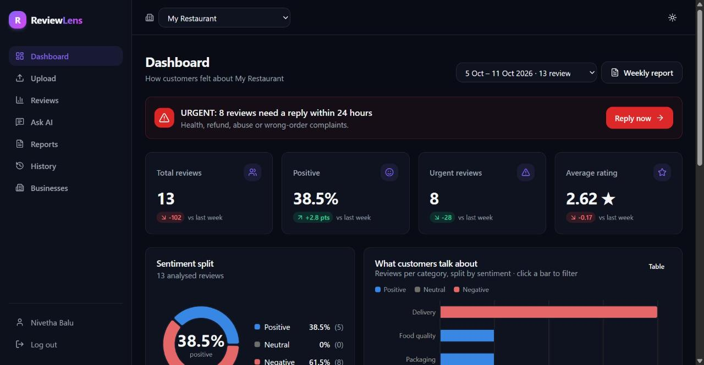
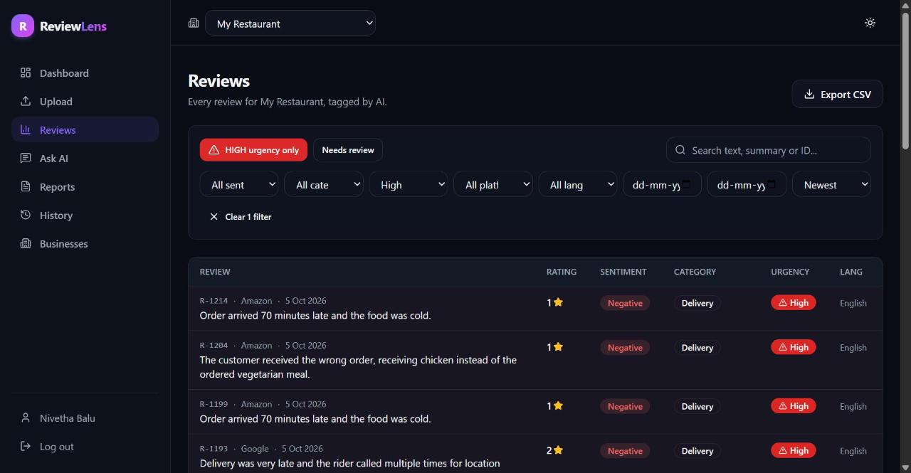
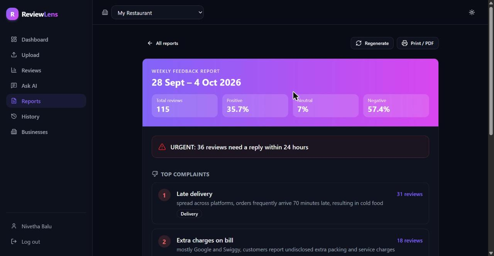

# ReviewLens: Customer Feedback Analyzer

> Turn hundreds of raw customer reviews (English, Tamil, Tanglish) into tagged, prioritised insights, a weekly report a manager can act on in five minutes, and an AI you can ask questions about your reviews.

Built from the MicroSaaS template (`INITIAL.md` → `PRPs/reviewlens-prp.md`). Track 01 (Gen AI / LangChain) of `SocialEagle_UseCase_Definitions.pdf`, with a full React UI instead of Streamlit.

## Screenshots

| Dashboard | HIGH urgency filter | Weekly report |
|---|---|---|
|  |  |  |

## Sample input and output

Real output from uploading `backend/tests/fixtures/reviews_week40.csv` (223 rows: 220 analysed, 3 empty rows dropped).

**Input** (`reviews_week40.csv`, excerpt)

```csv
review_id,date,platform,rating,review_text
R-1006,2026-09-27,Zomato,1,"Ordered at 8pm, came at 9:10. Food fully cold. Very bad."
R-1090,2026-09-26,Google,2,Saapadu nalla irundhuchu but bill la extra charge pottanga
```

**Output A: one analysed review** (`GET /api/v1/reviews/{id}`, trimmed)

```json
{
  "review_id": "R-1006",
  "sentiment": "negative",
  "category": "delivery",
  "urgency": "high",
  "language": "English",
  "summary": "Order arrived 70 minutes late and the food was cold.",
  "suggested_reply": "We sincerely apologize for the delay and the condition of your food upon arrival. Please DM us your order ID so we can address this issue promptly."
}
```

The Tanglish review R-1090 comes back as `negative · price · medium · Tanglish` with the English summary *"Food was good but the customer was charged extra on the bill."*

**Output B: weekly insights report** (Reports page, week of 28 Sept 2026)

```text
WEEKLY FEEDBACK REPORT  |  28 Sep to 4 Oct 2026
Total reviews: 115   Positive 35.7%   Neutral 7%   Negative 57.4%

TOP 3 COMPLAINTS
  1. Late delivery ............ 31 reviews  (spread across platforms, orders arrive ~70 min late and cold)
  2. Extra charges on bill .... 18 reviews  (mostly Google and Swiggy, undisclosed packing/service charges)
  3. Rude staff ............... 6 reviews   (spread across platforms, staff rude when asked for water)

TOP PRAISE
  Biryani taste (30 mentions), Neat packaging (8), Quick delivery (2)

URGENT: 36 reviews need a reply within 24 hours

ACTION ITEMS
  1. Reply to urgent reviews today, focusing on delivery issues and food quality concerns.
  2. Review and update the menu to clearly display all charges, including packing and service fees, by next week.
  3. Conduct staff training sessions to improve customer service, particularly in handling requests for water.
```

Every count, percentage and platform split above is calculated in pandas/SQL and matches the Reviews table. The LLM writes only the titles, pattern notes and action items.

## Features

| | |
|---|---|
| **Upload & analyse** | Drop a weekly CSV (`review_id, date, platform, rating, review_text`). pandas validates it, drops empty/invalid rows, skips already-analysed IDs. A background job runs a LangChain LCEL chain (`prompt | ChatOpenAI.with_structured_output(ReviewAnalysis)`) via `chain.batch(max_concurrency=…)`, with a live progress bar. |
| **Strict structured output** | sentiment · category · urgency · language · one-line English summary · polite suggested reply. Invalid output is retried automatically, then marked *needs review*. |
| **Reviews table** | Filters (HIGH urgency toggle, needs-review, sentiment, category, platform, language, dates, search), detail panel, copy reply, edit AI tags, Excel-friendly CSV export (UTF-8 BOM). |
| **Dashboard** | KPI tiles with week-over-week trend arrows, sentiment donut, category × sentiment chart, platform volume, urgent list. All numbers are computed in pandas, never by the LLM. |
| **Weekly report** | Map → reduce: pandas stats + a report chain that writes complaint titles, praise and exactly 3 action items. Counts are attached from pandas. Print / PDF. |
| **Ask your reviews (RAG)** | Reviews are embedded (`OpenAIEmbeddings`) into **pgvector** via `langchain_postgres.PGVector`. A LangChain retrieval chain answers questions using only the selected business's reviews, citing review IDs, with filters by week, sentiment, category and platform. |
| **Multi-business SaaS** | Email/password + Google OAuth (JWT access + rotating refresh tokens), several businesses/outlets per user, strict ownership checks. |

## Tech stack

FastAPI · LangChain (langchain-core, langchain-openai, langchain-postgres) · pandas · PostgreSQL 16 + pgvector · SQLAlchemy 2 + Alembic · React 18 + TypeScript + Vite · Tailwind + shadcn-style UI + Framer Motion · TanStack Query/Table · Recharts.

## Run it

**Prerequisites:** Docker Desktop (running) and Node 20+.

```bash
# 1. Configure the backend (already created for you, if missing copy the example)
cp backend/.env.example backend/.env      # then set OPENAI_API_KEY=sk-...

# 2. Start Postgres (pgvector) + backend with hot reload
docker compose -f docker-compose.dev.yml up --build

# 3. Start the frontend
cd frontend
npm install
npm run dev                                # http://localhost:5174
```

- API docs: http://localhost:8000/docs
- Sample data: `frontend/public/sample-reviews.csv` (20 rows), `backend/tests/fixtures/reviews_week40.csv` (223 rows, 3 weeks)

Full stack in containers (frontend on http://localhost:3000): `docker compose up --build`.

> **Windows note:** if *Smart App Control* is on, native Python wheels (numpy, psycopg, xxhash) are blocked, so run the backend in Docker as shown above. The frontend uses Rollup's WebAssembly build (`overrides` in `package.json`) for the same reason.

### Google login (optional)

Create OAuth credentials in Google Cloud Console with redirect URI `http://localhost:8000/api/v1/auth/google/callback`, then set `GOOGLE_CLIENT_ID` / `GOOGLE_CLIENT_SECRET` in `backend/.env`.

## Tests & checks

```bash
# Backend (inside Docker: SQLite + fake LLM + in-memory vector store, no OpenAI calls)
docker compose -f docker-compose.dev.yml run --rm backend sh -c "ruff check . && pytest --cov=app"

# Frontend
cd frontend && npm run lint && npm run type-check && npm test && npm run build
```

## Cost (OpenAI)

About 600–800 tokens per review for tagging plus about 100 for the embedding. A 250-review week costs a few cents on a mini-class model. Analysis takes about 1–3 minutes with `LLM_MAX_CONCURRENCY=5`.

## Project layout

```
backend/app/
  llm/        client.py (only place the provider is chosen) · prompts.py · schemas.py · chains.py · rag.py
  services/   csv_service · analysis_service (batch + retry + index) · stats_service (pandas) · report_service
  routers/    auth · businesses · uploads · reviews · stats · reports · ask
frontend/src/
  pages/      Dashboard · Upload · Reviews · Ask · Reports · Businesses · Auth · Account
  components/ ui · layout · charts · reviews · upload
```
